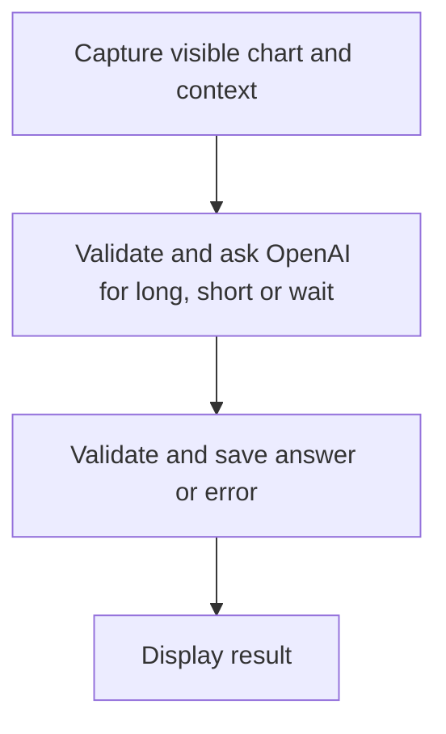

# Assignment Decision API

The main **Decision API** button captures the actual visible chart, including
volume and displayed overlays. It does not reconstruct a frozen chart from database
rows. Pinned candle selection does not change the capture cutoff: context identifies
the last visible candle, as in the classroom example. Scroll/zoom before capturing
to choose the evidence. A forming candle is permitted.

## Input and choice contract

`POST /api/decisions` accepts `{"capture": {...}}` with exactly these fields:

- `image`: PNG data URL from the live chart canvas.
- `ticker`, `interval`, `captured_at`, `candle_timestamp`, `visible_candles`.
- `last_quote_at`, `last_source_at` (nullable), `is_stale`, `volume_status`.

The server rejects extra capture fields, invalid timestamps/counts and invalid or
blank PNGs before calling the provider. Bounds, CRC and decoded image validation
reuse the existing PNG validator. Snapshot-bound PNGs from the paper workflow are
rejected by this classroom handler. Source times are provider-derived, not independently
verified. Freshness is conservative: disconnected, replay, missing-source-time and
old data are marked stale. Unknown volume is unavailable, never invented as zero.

The outgoing request contains one `input_text` caveat, one `input_json` object
with only identifying context, one `input_image`, and one choice question.
No OHLCV arrays, calculated indicator values, crossover labels, balances, positions,
strategy rules or prior answers are sent separately from the image. Static choice
instructions match the supplied assignment. Choices are exactly `long`, `short`,
`wait`, without position-aware hold/exit meanings. The backend uses OpenAI Decisions
`POST /v1/decisions` with `gpt-6-luna` through the existing HTTP adapter.
[Official Decisions guide](https://developers.openai.com/api/docs/guides/decisions).

## Display, storage and errors

The summary prioritizes the validated choice/status and ticker, interval, freshness
and volume status. **Decision details** contains the record ID, provider/model and
saved context/question/answer, including timestamps. The PNG remains saved without
an on-page preview or image link. It retains optional confidence/probabilities when
supplied without requiring them. The model supplies no written rationale. Failures
show missing credentials, timeout, refusal, malformed response or provider error;
none substitutes a wait choice. Invalid capture input returns HTTP 422. Provider
errors are stored with a null choice and sanitized codes, never arbitrary provider
text or credentials. There is one bounded provider call and no retry or reviewer.

The additive `classroom_decisions` SQLite table stores the image and result separately
from paper decisions. `GET /api/decisions/{id}` retrieves a saved result and
`GET /api/decisions/{id}/image` retrieves its exact PNG. This path never reads
market records, looks up an account, or creates paper orders/automation attempts.
Long/short are interpretations only. It does not add a chart marker.

**Review paper proposal** retains the prior snapshot/image analyst/reviewer controls.
**Trade → Automation** continues using its existing buy/sell/hold/wait/close
workflow and frozen numeric evidence. Classroom records cannot be applied through
that workflow. Existing paper records are preserved. Voice continues to use paper
decision records; it does not automatically discuss a classroom result.

## Educational flowchart

Four concise stages appear under **How the Decision API works**:



## Configuration and verification

Use project-root `.env` beside frontend/backend; `.env.example` is a placeholder.
Precedence: existing process environment, root `.env`, legacy `backend/.env` fallback.
Restart FastAPI after changes. No credential values need to be displayed or moved.
Both `.env` paths are already ignored by Git. No new package is required.

```bash
PYTHONPATH=backend/.packages /usr/bin/python -m unittest backend.test_classroom_decisions backend.test_automation -v
PYTHONPATH=backend/.packages /usr/bin/python -m scripts.classroom_smoke --output /tmp/arbitrade-classroom-results
PYTHONPATH=backend/.packages /usr/bin/python -m scripts.automation_smoke --output /tmp/arbitrade-classroom-automation
```

The classroom SmokeTest starts isolated services and Chromium, captures the chart,
compares visible answers with storage, audits the outgoing image/context payload,
checks all paper records and cleans up. It tests long/short/wait and controlled
malformed/timeout/provider failures without loading `.env` or making a live model
request. The automation browser check separately exercises the paper path.
See [verification](verification.md) for observed results and limitations.
